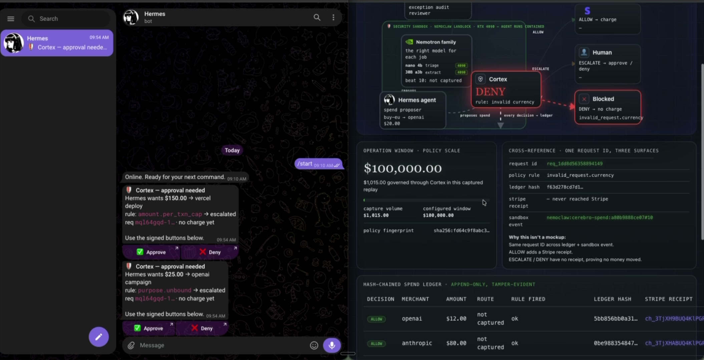
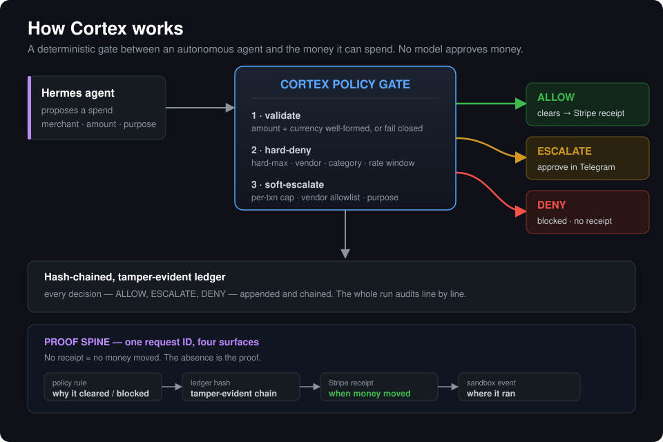

# Cortex: The Spend-Control Plane for Autonomous Agents

[](https://github.com/cerebrocybersolutions/cortex-governor/actions/workflows/tests.yml) -blue) 

Policy, approval, audit, and payment control between any autonomous agent and the
money it can spend. The layer that lets a company safely give an agent a budget.

## Quickstart

Python 3.9+. Standard library only: no dependencies, no API keys, no network.

```bash
git clone https://github.com/cerebrocybersolutions/cortex-governor
cd cortex-governor
python3 demo_scenario.py     # 12-beat policy walk + ledger tamper test, exits 0 on PASS
python3 autonomous_demo.py   # escalate -> human approve -> resume loop
python3 -m pytest -q         # 55 tests
```

The demo scenario runs offline against a derived demo policy (the shipped
`policy.json` with the rate window tightened so the finale trips in 12 beats).
No real money can move: the Stripe path is test-mode only and is not touched
by any of the commands above.

## Demo

[](https://x.com/CerebroCy/status/2068055618586550481)

▶ **[Watch the 77-second demo](https://x.com/CerebroCy/status/2068055618586550481)** — a NousResearch Hermes
agent buys tools for a real business workflow. Cortex clears the routine spend (Stripe test-mode receipt),
holds the unusual ones for a tap-to-approve in Telegram, and blocks the risky charge before a dollar moves.
Every decision reconciles across the policy rule, the ledger hash, the Stripe receipt, and the sandbox event.

## The problem

Agents are starting to earn and spend on their own. The open problem is not
autonomy. It is control. No business hands an agent a payment method without spend
limits, an audit trail, and a human in the loop for the decisions that matter.

## How it works



Hard-deny rules are evaluated before soft-escalate rules, so a denied vendor,
category, or over-ceiling spend can never be downgraded into an approvable
escalation. Every decision is appended to a hash-chained, tamper-evident ledger.

## Policy scale (an honest note on the window)

The binding constraints are the per-transaction caps: **`per_txn_cap` $100**
(above it escalates to a human) and **`hard_max` $500** (above it is denied,
period). Those are what gate every single spend.

`policy.json` also carries a `rate_window` of `max_count` 100 and `max_amount`
$100,000 per hour. Read honestly: the $100k amount window can never actually bind,
because `max_count` 100 transactions x `hard_max` $500 = **$50,000** is the true
per-hour ceiling. The $100k figure is enterprise headroom, not the operative
limit — the per-transaction caps and the count window bind first by design. We
keep it visible rather than quietly tuned because tight per-txn caps are the
governance strength, and a control plane should not advertise a ceiling it does
not enforce.

## Why it is real, not a mockup

The dashboard replays a real captured run. For an allowed charge, the same request
id reconciles across the ledger entry, the Stripe test-mode receipt, and the
sandbox event. One id, three surfaces. Escalated and denied spends carry no
receipt, and that absence is proof no money moved. The money path runs in Stripe
test mode; no real funds move.

## Try it

- `cortex-enhanced.html` - the enhanced control surface + **live policy playground**. Send
  your own spend request through the same policy and rule logic the gate enforces (a faithful
  in-browser port of `policy_engine.py`) and watch ALLOW / ESCALATE / DENY with the exact rule
  that fired — plus a replay, a ledger explorer, and analytics.
- `index-live.html` - the captured demo run: the dashboard from the video, replayed card by
  card with the full proof spine, real Stripe test-mode receipts, and a hash-chained ledger,
  peaking on a blocked $600 over-limit spend.
- `index.html` - a locked snapshot of that run (frozen; the live build cannot clobber it).

## On-prem by design

The agent reasons on a local RTX 4090 inside a Landlock-confined NemoClaw sandbox
(an NVIDIA OpenShell environment), with NVIDIA Nemotron screening every spend. The
workflow is Hermes-native (NousResearch). Nothing about the control plane requires
the cloud, which is what makes it deployable for regulated teams.

## The product path

Open-source governor (this repo) to a hosted approval and audit layer to an on-prem
deployment for regulated teams. Built by Cerebro Cyber Solutions, an operating
company. Cortex is not a more autonomous agent. It is the control plane that lets a
real business safely let agents run.

## The code

- `policy_engine.py` - the gate: validate, deny-pass, escalate-pass, allow.
- `governor.py` / `ledger.py` / `escalation.py` - orchestration, hash-chained
  ledger, human-approval resolution.
- `policy.json` - the enforced policy: caps, allow / deny lists, rate window.
- `cortex-enhanced.html` - control surface + live policy playground.
- `index-live.html` / `index.html` - the captured demo dashboard and its locked snapshot.
- `test_*.py` - 55 tests over the engine, ledger, escalation, capture gate, and crossref proof.

## License

Apache-2.0. See [LICENSE](LICENSE).
